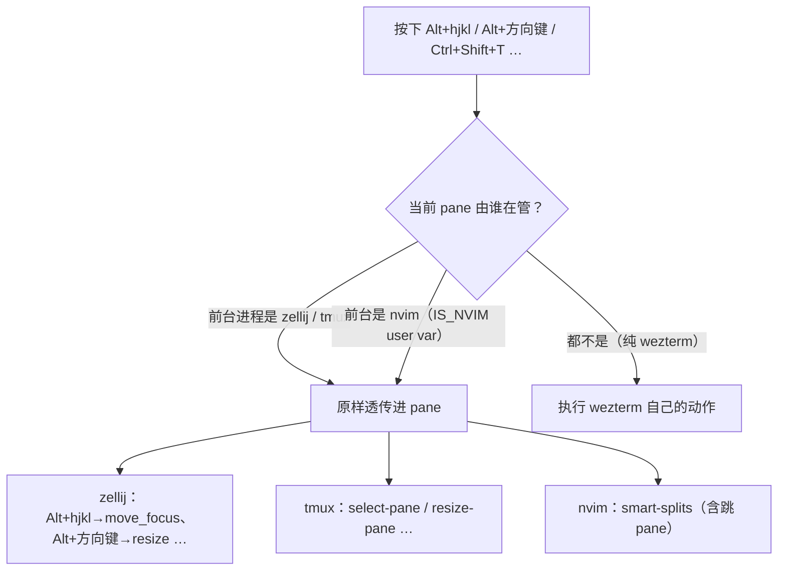
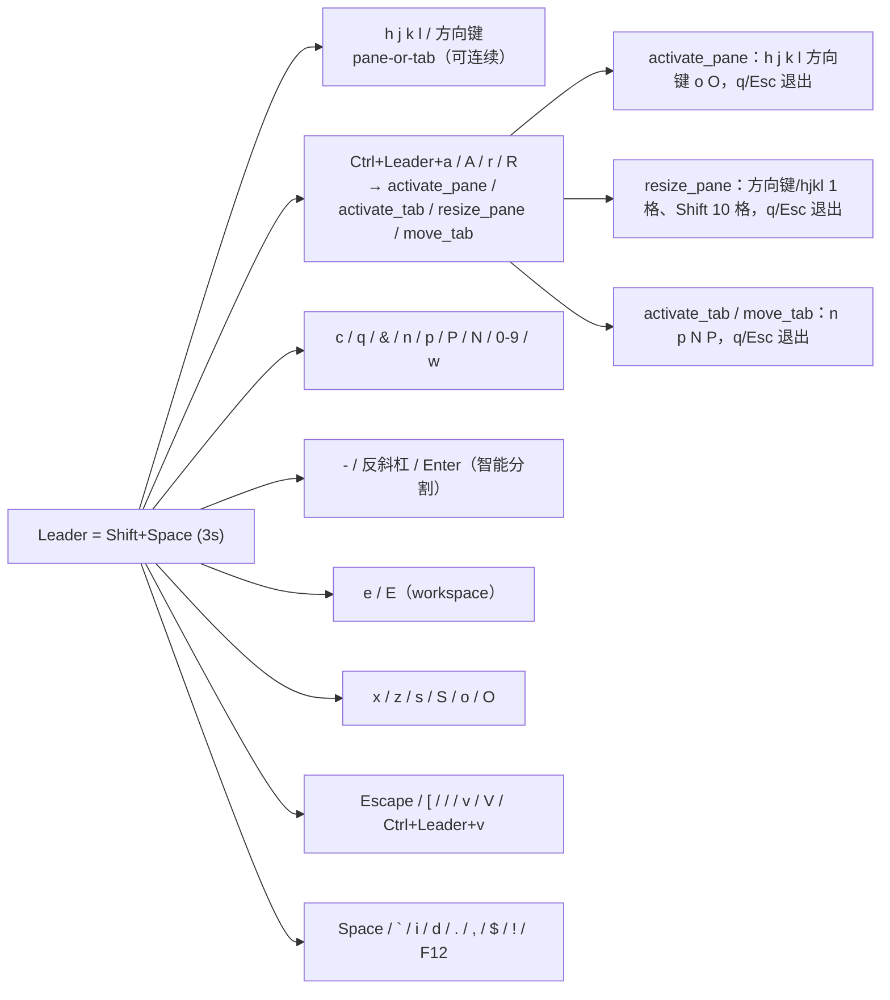

# wezterm 键位表

整理自 `keybindings/{keys,key_tables,mouse}.lua` 与 `style/{opacity,dynamic_ui}.lua`、`utils/save_output.lua`（2026-09-21）。改键位时请同步本文件。

> 交互式版本：同目录 **`keymap.html`**（按层高亮、点键看各层作用）、**`compare.html`**（wezterm / tmux / zellij 前缀层三边对照，可只看差异）。
> 校验：`node keymap_check.mjs`（键位数据）、`node compare_check.mjs`（对照表数据 + 渲染逻辑）。

- **Leader**：`Shift+Space`（超时 3s）
- `disable_default_key_bindings = true`：下表之外没有 wezterm 默认键
- `enable_kitty_keyboard = true`：单 tab 透传用 kitty 协议序列（见下）

## 1. 按键归属：先判断“谁在管这个 pane”

`Alt+hjkl`、`Alt+方向键`、`Alt+n`、`Alt+0`、`Alt+[`/`]` 这些键先做一次判定（`keybindings/passthrough.lua` + `utils/mux.lua`）：



判定细节：先看 user var（`TMUX`/`ZELLIJ`，兼容信号），再看标签栏渲染时顺手缓存的 `PaneInformation.foreground_process_name`（5s 内直接采信），最后才按 2s TTL 直接查一次前台进程名——稳态零额外 `/proc`。

## 2. 全局（无前缀）

| 键 | 动作 |
| --- | --- |
| `Ctrl+Shift+V` / `Ctrl+Shift+S` | 粘贴系统剪贴板 / 主选区 |
| `Ctrl+Shift+C` | 复制到剪贴板 |
| `Ctrl+Shift+F` | 搜索 |
| `Ctrl+Shift+P` | 命令面板 |
| `Ctrl+Shift+Space` | QuickSelect |
| `Ctrl+Shift++` / `_` / `)` | 字号 + / − / 重置（`Ctrl+滚轮` 同效） |
| `Ctrl+C` | 有选区则复制，否则原样透传给 pane |
| `Ctrl+Shift+A` | tab 导航器（A = all tabs；`F1` 已解绑，还给 TUI 应用） |
| `Ctrl+Shift+←` / `→` | 上一个 / 下一个 tab |
| `Ctrl+Shift+PageUp` / `PageDown` | 整页滚动（`Shift+PageUp/Down` 为半页） |
| `Ctrl+Shift+K` / `J` | 上 / 下滚 3 行；`Ctrl+Shift+↑` / `↓` 为 1 行 |
| `Ctrl+Shift+Home` / `End` | 滚到顶 / 底 |
| `Ctrl+Shift+Delete`、`Super+k` | 清空 scrollback |
| `Ctrl+Shift+<` / `>`、`Ctrl+Alt+Shift+{` / `}` | 向左 / 右移动 tab |
| `Ctrl+Alt+Shift+C` | 把最近一次命令输出写进剪贴板（OSC133 语义区 + `wl-copy`） |
| `F11` | 全屏切换 |
| `F12` | 锁定：所有键原样交给 pane 内程序（等价 zellij Locked / tmux 的 F12 key-table off）；再按一次解锁 |

### 层级自适应的四个键（`Ctrl+Shift+T` / `W`、`Ctrl+Tab`、`Ctrl+Shift+Tab`）

- **有多个 wezterm tab** → 由 wezterm 处理（新建 / 关闭 / 前后切换）
- **只有一个 tab** → 用 kitty 协议序列写进 pane，交给内层 tmux/zellij/nvim：

| 键 | 序列 | 说明 |
| --- | --- | --- |
| `Ctrl+Shift+T` | `\x1b[84;6u` | 码位是大写 `T`=84（`SendKey` 会归一化成小写 116，不可用） |
| `Ctrl+Shift+W` | `\x1b[87;6u` | 大写 `W`=87 |
| `Ctrl+Tab` | `\x1b[9;5u` | Tab=9，5 = 1 + Ctrl |
| `Ctrl+Shift+Tab` | `\x1b[9;6u` | 6 = 1 + Shift + Ctrl |

## 3. pane

### 导航（`Alt` 系列会先判断是否透传）

| 键 | 行为 |
| --- | --- |
| `Alt+h` / `j` / `k` / `l` | 复用器/nvim 里透传；否则切 wezterm pane（左右到边界切 tab） |
| `Alt+[` / `Alt+]` | 上一个 / 下一个 pane（同样先判断透传） |
| `Ctrl+Alt+h` / `l` | pane-or-tab 左 / 右（直接执行，不透传判断） |
| `Ctrl+Alt+j` / `k` | 上 / 下 pane |

### 调整大小

| 键 | 行为 |
| --- | --- |
| `Alt+方向键` | 5 格（先判断透传：在 mux/nvim 里交给内层） |
| `Shift+Leader+H J K L` / `Shift+Leader+方向键` | 先调 10 格，随后进入 `resize_pane` 表可连续调 |
| `Ctrl+Alt+Shift+H J K L` | 直接调 10 格 |
| `Leader+Ctrl+r` | 进入 `resize_pane` 表（5s 超时） |

### 分割 / 关闭 / 缩放

| 键 | 行为 |
| --- | --- |
| `Alt+n` | 智能分割（按 pane 长宽比选上下或左右；先判断透传） |
| `Leader+Enter`、`Ctrl+Alt+Enter`、`Ctrl+Shift+Enter` | 同上，智能分割 |
| `Leader+−` / `Leader+反斜杠`，`Ctrl+Alt+−` / `Ctrl+Alt+反斜杠` | 纵向 / 横向分割 |
| `Leader+x` | 关闭当前 pane |
| `Leader+z` | 切换 zoom（`m` 已解绑） |
| `Leader+s` | pane 编号选择（1-9） |
| `Leader+f` | 跨 pane 模糊搜索（脚本 + fzf + 右侧预览）→ 选中即跳过去 |

### `Leader+f`：跨 pane 模糊搜索（脚本 + fzf，与 tmux 共用）

- **绑定**：`act.SplitPane`（下方 40%）跑 `~/scripts/misc/mux-find-pane.sh wezterm`；tmux 侧 `C-s f` 用 `display-popup` 跑同一脚本（参数 `tmux`）。
- **候选来源**：每个 pane 的可见内容 + 最近 `MUX_FIND_LINES`（默认 2000）行历史（`wezterm cli get-text --start-line -N` / `tmux capture-pane -S -N`）；含 powerline/框线字形的装饰行在脚本里用 `grep -vP` 过滤（所以 zellij 状态栏、p10k 提示符都不会进候选）。
- **交互**：fzf 模糊匹配（标题 + 内容），右侧实时预览，回车跳转（`wezterm cli activate-pane` / `tmux select-pane`），临时 pane / popup 自动关闭。
- **不再使用 `InputSelector`**：这版的回调不回传选中项。原生实现（OSC 133 语义区取候选 + 装饰行过滤）保留在 `keybindings/find_pane.lua`，当前未挂载，想切回去时在 `keys.lua` 里接回即可。
| `Leader+S` | 选中并与当前 pane 交换 |
| `Alt+Leader+o` / `Alt+Leader+O` | 逆 / 顺时针轮换 pane |
| `Leader+o` / `Leader+O` | 下一个 / 上一个 pane（到边界切 tab；触发后进入 `activate_pane` 表） |

## 4. tab / workspace

| 键 | 行为 |
| --- | --- |
| `Leader+c` | 新建 tab |
| `Leader+q` / `Leader+Shift+&` | 关闭 tab（不确认 / 确认） |
| `Leader+n` / `p` | 下一个 / 上一个 tab（进入 `activate_tab` 表，可连续切） |
| `Leader+0-9`、`Alt+0-9`、`Ctrl+Alt+0-9` | 直接切到第 N 个 tab（`0` = 最后一个） |
| `Ctrl+Alt+[` / `]` | 上一个 / 下一个 tab |
| `Leader+P` / `N` | 向左 / 右移动 tab（进入 `move_tab` 表） |
| `Leader+w` | tab 导航器 |
| `Leader+e` / `Shift+Leader+E` | 切换工作区 / 上一个工作区（smart_workspace_switcher） |
| `Leader+,` / `Shift+Leader+$` | 重命名 tab / 工作区 |

## 5. Leader 结构图

```
Leader+               :  c 新tab   e 工作区   h j k l pane-or-tab   m/z zoom     o/O pane↔tab
                         n 下一个tab   p 上一个tab   q 关tab   s 编号选pane   w tab导航器   x 关pane
                         v 复制(cell)   方向键 pane-or-tab   - / 反斜杠 分割   Enter 智能分割
                         f 跨 pane 模糊搜索（选中即跳；脚本 + fzf + 右侧预览）
                         Space 启动器   ` 域/工作区/tab   i/d 附接/分离 domain   . 移到新窗口   , 改名tab
                         g 锁定（等价 zellij Locked；退出按 F12）
Shift+Leader+         :  H J K L 调大小(10格)   V 复制(line)   E 上个工作区   $ 改名工作区
                         ! 移到新tab   & 关tab   0-9 切tab
Ctrl+Leader+          :  a activate_pane 表   A activate_tab 表   r resize_pane 表   R move_tab 表
                         [ 复制模式   o 透明度切换
Ctrl+Shift+Leader+    :  （同 A / R）
```



## 6. 复制模式与滚动（`Leader+Escape` / `Leader+[` / `Leader+/` 或 `Ctrl+Leader+[` 进入）

`key_tables.lua` 的 `copy_mode` 是完整 vi 风格：

- 移动：`h j k l`、`w b e`、`0 ^ $`、`H M L`、`g G`、`Ctrl+u/d/b/f`、`f t F T`、`; ,`
- 选择：`v`（cell）、`V`（line）、`Ctrl+v`（block）、`o`/`O` 换端点
- 复制/退出：`y`（复制并回到底部）、`Ctrl+c`（关闭并回到底部）、`i`（取消选择并关闭）、`Escape`（取消选择）
- 语义区跳转：`J` `K` `n` `p` `x` `z`（对应 OSC133 的输出区）
- 从普通模式直接进指定选择模式：`Leader+v`（cell）、`Shift+Leader+V`（line）、`Ctrl+Leader+v`（block）
- OSC133 prompt 跳转：`Shift+↑` / `Shift+↓`（`ScrollToPrompt`）

## 7. 鼠标（`mouse.lua`）

| 操作 | 行为 |
| --- | --- |
| 右键 | 有选区则复制，否则粘贴 |
| `Ctrl+左键` | 打开光标下的链接 |
| 左键抬起 | 不自动打开链接（默认行为被关掉） |
| `Ctrl+滚轮` | 放大 / 缩小字号 |
| 左键四连击 | 按语义区（SemanticZone）选中 |

## 8. wezterm 自身事件

| 触发 | 处理器 | 位置 |
| --- | --- | --- |
| `Ctrl+Leader+o` | `EmitEvent("toggle-opacity")` → 在“配置透明度”与“完全不透明”间切换 | `style/opacity.lua` |
| `Ctrl+Alt+Shift+C` | `EmitEvent("save-output")` → 取最近一次命令输出写剪贴板 | `utils/save_output.lua` |
| 每 tick | `alt-screen` 时滚动条透明；复用器里单 pane 时隐藏 tab 条 | `style/dynamic_ui.lua` |

## 9. 附录：三边前缀层完整对照（wezterm `Leader+` / tmux `C-s` / zellij tmux 模式）

tmux 一列写的是「默认 → 你的覆盖」；⚠️ 表示**同一个按键在不同层含义不同**。数据来源：`keybindings/keys.lua`、`~/.config/tmux/conf/keys/*.tmux`（默认值取自本机 `tmux.1` 的 DEFAULT KEY BINDINGS）、`~/.config/zellij/config.kdl` 的 `tmux` 模式。

| 键 | wezterm `Leader+` | tmux `C-s`（默认 → 覆盖） | zellij tmux 模式 | 判定 |
| --- | --- | --- | --- | --- |
| `c` | 新建 tab | `c` new-window（带 cwd） | NewTab | ✅ |
| `d` | detach domain | `d` detach（默认） | Detach | ✅ |
| `e` / `E` | 切换 / 上一个工作区 | `e` choose-session、`E` switch-client -l | `e` session-manager 插件 | ✅ 相近 |
| `f` | **跨 pane 模糊搜索并跳转**（脚本 + fzf） | 默认 find-window → **覆盖为同一脚本 + fzf** | `Run` 浮动 pane 跑**同一脚本**（选完自毁） | ✅ 三边同一实现 |
| `g` | ✗ | ✗ | 进 Locked | 仅 zellij |
| `h j k l` | pane 移动（可连续） | `-r hjkl` select-pane | MoveFocus（可连续） | ✅ |
| `H J K L` | 调整 10 格 | `-r H/J/K/L` resize 5（另有 `-r S-方向键` 重复，未清理） | Resize（1 格/次） | 同义，步长不同 |
| `i` | attach domain | `i` 显示窗口信息（默认） | ✗ | ⚠️ **不同** |
| `m` | （已删） | `m` 标记 pane（默认） | ✗ | ⚠️ 仅 tmux |
| `M` | ✗ | `M` 清除标记（默认） | ✗ | 仅 tmux |
| `n` / `p` | 下一个 / 上一个 tab | next / prev window（默认） | 下一个 / 上一个 tab | ✅ 三边 |
| `N` / `P` | 右移 / 左移 tab | swap-window +1 / −1 | MoveTab 右 / 左 | ✅ |
| `o` / `O` | 下一个 / 上一个 pane-or-tab | `o` 下一个 pane（默认）；`O` **新增** `select-pane -t :.-` | FocusNextPane / **FocusPreviousPane**（`O` 为本次新增） | ✅ 三边同键（边界环绕语义仍不同） |
| `q` | 关 tab（不确认） | **覆盖为 kill-window** | CloseTab | ✅（tmux 默认是 display-panes） |
| `r` | ✗（`Ctrl+Leader+r` = resize 表） | `r` 强制重绘（默认） | ✗ | ⚠️ **不同** |
| `R` | ✗（`Ctrl+Shift+Leader+R` = move-tab 表） | `R` 重载配置（source-file） | ✗ | ⚠️ **不同** |
| `s` | pane 编号选择（PaneSelect） | **覆盖为 display-panes** | **借 fzf picker**（列表选择，无编号覆盖层；本次新增） | ≈ |
| `S` | 选定并交换 pane（标签选择） | **新增** `display-panes` + `swap-pane -t`（编号选择） | `MovePane`（只能和相邻换位） | ≈ 相近 |
| `t` | ✗ | 默认时钟（clock-mode，choose-tree 覆盖已撤回） | ✗（原 Tab 模式入口已移除） | 仅 tmux |
| `v` / `V` | 复制模式 + cell / line 选择 | ✗（copy-mode 内 `v`） | ✗ | 仅 wezterm |
| `w` | tab 导航器 | choose-tree（窗口，默认） | ✗ | ✅ 相近 |
| `x` | 关 pane | kill-pane（默认） | CloseFocus | ✅ |
| `z` | zoom | zoom（默认） | 全屏 | ✅ |
| `0-9` | 切到第 N 个 tab | select-window（默认） | **GoToTab 1-9**（新增；zellij 没有“第 0 个/最后一个”的直接动作） | ≈ 三边都有（zellij 缺 0） |
| `!` | pane 移到新 tab | break-pane（默认） | **BreakPane**（新增） | ✅ |
| `[` | 复制模式 | copy-mode（默认） | Scroll | ✅ |
| `]` | ✗ | paste-buffer（默认） | ✗ | 仅 tmux |
| `-` | 纵向分割 | **覆盖为 split -v** | NewPane Down | ✅（tmux 默认是删 buffer） |
| `\` | 横向分割 | split -h | NewPane Right | ✅ |
| `Enter` | 智能分割（按长宽比） | split -v + 重排布局 | NewPane Down | ✅ 相近 |
| `Escape` | 进复制模式 | ✗（默认无） | 回 Normal | ⚠️ **不同** |
| `Space` | 启动器 | 下一个预设布局（默认） | 下一个 swap 布局 | ⚠️ **不同** |
| `Tab` | ✗（只有 `Ctrl+Tab`） | ✗ | ✗ | — |
| `,` | 重命名 tab | rename-window（默认） | RenameTab | ✅ 三边 |
| `.` | pane 移出新窗口 | **覆盖为 break-pane** | ✗ | ✅（tmux 默认是移动窗口到指定编号） |
| `;` | 上一个 pane | last-pane（默认） | FocusLastPane | ✅ 三边 |
| `!` | pane 移到新 tab | break-pane（默认） | ✗ | ✅ |
| `$` | 重命名工作区 | rename-session（默认） | ✗ | ✅ |
| `&` | 关 tab（确认） | kill-window（默认） | CloseTab | ✅ 三边 |
| `` ` `` | 域/工作区/tab 启动器 | ✗ | ✗ | 仅 wezterm |
| `{` / `}` | ✗（`Ctrl+Alt+Shift+{ }` = 移动 tab） | swap-pane 前 / 后（默认） | ✗ | ⚠️ 键同层不同 |
| `F12` | debug overlay | 挂起按键（root 表 key-table off） | locked（用 `g` 进） | ⚠️ **三者不同** |
| 方向键 | pane-or-tab | 切 pane（默认） | MoveFocus + 回 Normal | ✅ 相近 |
| `PageUp` | ✗ | 进 copy-mode 翻页（默认） | ✗ | 仅 tmux |
| `C-s`（前缀自身） | ✗ | send-prefix | `Write 19`（等价） | ⚠️ wezterm 缺 |
| `Ctrl+Leader+a/A/r/R/[ /o/v` | activate 表 / activate_tab 表 / resize 表 / move_tab 表 / 复制模式 / 透明度 / 复制 block | ✗ | ✗ | 仅 wezterm |
| `#` `~` `:` `?` `=` `'` `(` `)` `"` `%` `C-o` `M-1..5` `M-n` `M-p` | ✗ | tmux 默认（列表 / 消息 / 命令 / 帮助 / buffer / 切会话 / 分割 / 轮转 / 预设布局 / 活动窗口跳转） | ✗ | 仅 tmux |

### 同键不同功能（需要记住的几处）

| 键 | wezterm | tmux | zellij tmux 模式 |
| --- | --- | --- | --- |
| `i` | attach domain | 显示窗口信息（默认） | ✗ |
| `S` | 选定并交换 pane（标签选择） | 交换 pane（编号选择，display-panes） | `MovePane`（仅相邻换位） |
| `t` | ✗ | 时钟模式（默认；选树覆盖已撤回） | ✗（原 Tab 模式入口） |
| `Space` | 启动器 | 下一个布局 | 下一个 swap 布局 |
| `Escape` | 进复制模式 | ✗ | 回 Normal |
| `F12` | debug overlay | 挂起按键 | locked（`g`） |
| `r` / `R` | 需带 `Ctrl+Leader+r` / `Ctrl+Shift+Leader+R` | 裸键：重绘 / 重载配置 | ✗ |
| `m` / `M` | 已删 / ✗ | 标记 / 清除标记（默认） | ✗ |
| `l` `L` | 覆盖后：pane 右移 / 调整 5 格 | 默认是 last-window / last-client，被配置覆盖 | — |

### root 表（无前缀）速查

| 功能 | wezterm | tmux `-n` | zellij shared 层 |
| --- | --- | --- | --- |
| pane 导航（nvim 内透传） | `Alt+h j k l` | `M-h j k l` | `Alt+h j k l` |
| 调整大小 | `Alt+方向键`(5) / `Ctrl+Alt+Shift+HJKL`(10) | `M-方向键`(5) | `Alt+方向键` |
| 新 tab / 窗口 | `Alt+t` | `M-t` | `Alt+t` |
| 切第 N 个 tab | `Alt+1..9`、`Ctrl+Alt+1..9` | `M-1..9` | `Alt+1..9` |
| 前后 tab | `Shift+←/→`、`Ctrl+Tab` | `S-left/right`、`C-Tab`、`M-Escape` | `Shift+←/→`、`Ctrl+Tab` |
| 新建 / 关闭 tab | `Ctrl+Shift+T` / `Ctrl+Shift+W` | 同 | 同 |
| 回到上一个 pane | `Ctrl+\` | `C-\` | `Ctrl+\` |
| prompt 跳转 | `Ctrl+↑/↓` | `C-Up/C-Down` | `Ctrl+↑/↓` |
| 移动 tab | `Alt+{ }` | `M-{ }` | `Alt+{ }` |
| 全屏 | `F11` | `F11` | — |
| 插件管理器（浮窗） | — | — | `Alt+m`（本次新增，直开 `plugin-manager`） |
